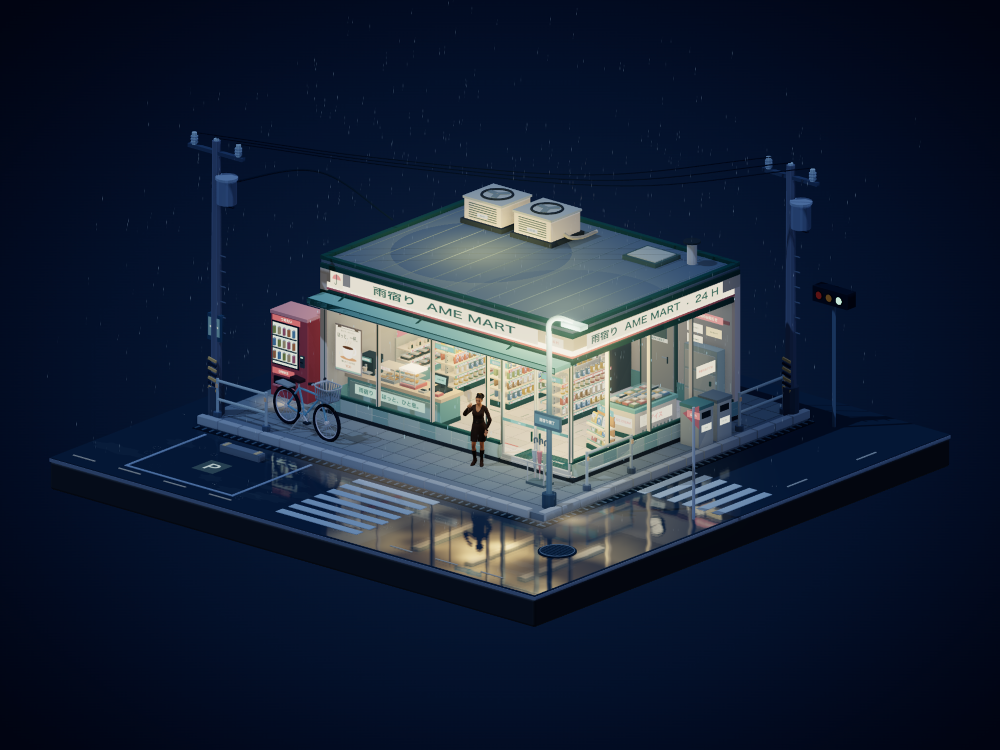

# 雨宿り · 雨夜便利店

一个可以自由旋转、平移和缩放的日式雨夜便利店微缩世界。暖色店内灯光、冷色街景、雨水和积水倒影，搭配安静的街角与门口吸烟的成年女性角色，场景没有按钮、面板或其他可见 UI。

[在线预览](https://ame-mart-rainy-corner.kanshao2077.chatgpt.site/) · [人物近景](https://ame-mart-rainy-corner.kanshao2077.chatgpt.site/?view=visitor) · [单文件 HTML](./雨夜便利店.html)



## 直接打开

下载根目录的 **`雨夜便利店.html`**，用支持 WebGL 的现代浏览器打开即可。它是完整的单文件，已经内嵌 Three.js、场景代码、人物模型、动画与全部贴图，不需要安装依赖，也不请求 CDN 或其他外部资源。

## 交互

- 鼠标左键拖动旋转，右键拖动平移，滚轮缩放。
- 触屏单指旋转，双指平移和缩放。
- 方向键调整角度，`+` / `-` 缩放，`Home` 恢复初始视角。
- 在页面地址后添加 `?view=visitor`，直接打开人物近景。
- 跟随系统的“减少动态效果”设置。

## 场景内容

- 明亮、完整的便利店内景：商品货架、饮料冷柜、便当饭团、收银台、咖啡机、关东煮、冰柜与杂志架。
- 街角细节：自动售货机、自行车、雨伞架、护栏、电线杆、电线、街灯、斑马线、停车位、排水沟与屋顶空调。
- 雨夜动态：持续降雨、屋檐滴水、玻璃雨痕、积水涟漪、湿地倒影、自动门、微弱灯光变化和缓慢转动的屋顶风扇。
- 成年女性角色：V 领收腰裙、长靴、盘发，带完整贴图和骨骼，包含夹烟姿势、轻微呼吸、转头、烟头微光与烟雾。
- 画面处理：卡通材质、冷暖配色、接触阴影、抗锯齿、柔和泛光和颜色调整。

## 本地开发

本项目已在 Node.js 24 和 pnpm 11.25.0 下构建验证。

```bash
pnpm install --frozen-lockfile
pnpm build
pnpm preview
```

预览地址：<http://127.0.0.1:4178/>。

构建会同时生成 `dist/index.html` 和根目录的 `雨夜便利店.html`。两者内容一致，可以把 `dist/` 部署到静态网站服务。

| 路径 | 内容 |
| --- | --- |
| `src/` | TypeScript 场景、材质、天气、人物与渲染代码 |
| `src/assets/` | 内嵌到 HTML 的人物模型与基础动画 |
| `scripts/build.mjs` | esbuild 打包与单文件 HTML 生成 |
| `scripts/serve.mjs` | 本地静态预览服务 |
| `dist/index.html` | 可部署的完整页面 |
| `雨夜便利店.html` | 可双击离线打开的完整页面 |

## 资源说明

人物使用 Microsoft Rocketbox 的 **Female Adult 11** 成年女性角色；压缩 GLB 和基础站立动画来自 [CodeLove 模型库](https://models.codelove.in/)，原始人物库是 [Microsoft Rocketbox](https://github.com/microsoft/Microsoft-Rocketbox)。Microsoft MIT 许可全文保存在 GLB 元数据内；Three.js 等依赖的许可保留在依赖和构建文件中。

[查看人物近景截图](./visitor-closeup.png)
